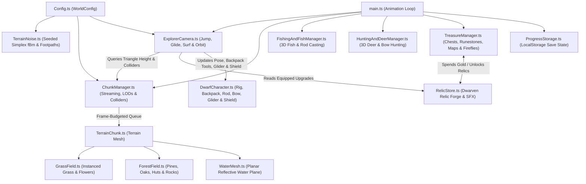

# Endless Procedural World

🌐 **Play Online:** [https://wandering-dwarf.netlify.app](https://wandering-dwarf.netlify.app)

An endless, deterministic 3D procedural world adventure built with **TypeScript**, **Three.js**, **Simplex Noise**, and **Vite**. Explore sweeping hills, winding forest footpaths, meandering rivers, natural pond basins, wind-swept meadows, and airy forest groves as a traveling dwarf—complete with expressive traversal (jumping, valley wind-gliding, downhill shield-surfing), **Backpack Fishing & 3D River Fish**, **Backpack Bow & Arrow Deer Hunting**, diegetic firefly treasure tracking, rune-sealed mythic chests, ancient stone circles & fast-travel watchtower beacons, and a **Dwarven Relic Forge**.

---

## How to Run

The game is published and playable directly in your browser at **[https://wandering-dwarf.netlify.app](https://wandering-dwarf.netlify.app)**. To run it locally:

### Prerequisites
- **Node.js** (v18+ recommended) and **npm**

### 1. Install Dependencies
```bash
npm install
```

### 2. Start the Development Server
```bash
npm run dev
```
Vite will start a local development server (typically at `http://localhost:5173`) with Hot Module Replacement (HMR). Open the printed URL in your browser.

### 3. Build & Preview for Production
```bash
# Type-check with TypeScript and bundle for production into dist/
npm run build

# Locally preview the production build
npm run preview
```

---

## Controls

| Input | Action |
| :--- | :--- |
| **`W` `A` `S` `D`** or **Arrow Keys** | Move dwarf / camera relative to view direction (or aim cast in Fishing Mode) |
| **`Shift`** (Hold) | Sprint (**+25% Trailblazer speed boost** on dirt footpaths, **+45%** with *Boots of the Strider*) |
| **`Space`** (Press / Hold in air) | **Jump** / **Double-Jump** (*Skyforge Greaves*) / Hold while descending to **Wind-Glide** (glide into lit **Watchtower Beacons** or volcano vents to catch soaring **Thermal Updrafts** $+24\text{m/s}$) |
| **`C`** or **`Ctrl`** (Press / Hold) | **Dodge-Dash** on flat ground, **Airborne Ground-Slam** in mid-air (shockwave shatters rocks, staggers Trolls & defeats Goblins), or **Downhill Surf-Ramming** on the *Ironbelly Surf-Shield* |
| **`F`** (or **🎣 Fish** HUD Button) | Equip / stow the **3D Fishing Rod** from the dwarf's backpack (`Click` / `Space` to cast & reel in fish) |
| **`E`** | **Lift** Natural Stones / mine **Mithril Veins**, chisel blocks at a Quarry, build Castle blocks, or enter Keep Drawbridge |
| **`Q`** | Set up a new **Stonemason Quarry** on level clearing |
| **`U`** | Upgrade Quarry to **Tier II Automaton Quarry** (300g — double cutting speed, 24 stockpile, automated block dispatch) |
| **`K`** | Stake a new **Castle Construction Site** on level clearing |
| **`1` `2` `3` `4`** | Unlock Dwarven Relics in the **Relic Forge** using collected Gold |
| **`B`** | Show / collapse the **Dwarven Relic Forge** HUD drawer |
| **`T`** | Fast-travel between lit **Watchtower Beacons** |
| **`N`** | Cycle **Time of Day** (Sunlit Morning → Golden Hour Sunset → Starry Night → Misty Dawn) |
| **Left / Right Mouse Drag** | Orbit camera around the dwarf (use **Right-Click Drag** while in Bow Hunting Mode) |
| **Mouse Wheel** | Zoom camera in / out (`4m` – `45m`) |
| **`V`** | Toggle Camera Mode (`dwarf` third-person follow vs. `free` high-speed overview) |
| **`M`** | Open the discovered **World Map** (`Shift+M` toggles terrain wireframe rendering) |
| **`Esc`** or **`O`** | Open **Game Menu** — **Pauses the game & music**, Save / Load / Restart |
| **`P`** | Pause / resume (mute / unmute) background music (*Wandering Through the Pines*) |
| **Top-Right GUI (`lil-gui`)** | Live-tune terrain noise, footpaths, water, forest groves, grass, wind, and reset saved progress |

---

## Architecture

The project is organized into modular subsystems under `src/`:

```text
procedural-world/
├── index.html                  # App shell & HUD overlay (Compass + Chest Pointer, Gold/Fish/Hunt HUD, Relic Forge, Controls)
├── 3dmodels/                   # Close-range GLB assets (dwarf, deer, pine, oak, dwarven hut, stone circle, grass clump, steam automaton, fantasy goblin)
├── art/                        # Concept art & visual reference sheets
├── music/                      # Background & ring-challenge soundtrack MP3s
└── src/
    ├── main.ts                 # Entrypoint: Scene, renderer, lighting, shadow frustum tracking, planar reflection & main loop
    ├── style.css               # HUD, compass pointer, streak pill, Fishing/Hunting banners, Relic Forge, and toast styling
    ├── world/
    │   ├── Config.ts           # WorldConfig interface & default tuning parameters
    │   ├── TerrainNoise.ts     # Mulberry32 PRNG, multi-octave fBm noise, winding footpaths, river/pond carving, surface coloring
    │   ├── ChunkManager.ts     # Endless grid streaming, distance LODs, frame-budgeted build queue, O(1) collision & height queries
    │   ├── TerrainChunk.ts     # Individual chunk mesh builder, vertex coloring, seamless normals, child attachments
    │   ├── GrassField.ts       # GPU-instanced grass tufts & wildflowers with custom wind/push vertex shaders
    │   ├── ForestField.ts      # GPU-instanced pines, oaks, dwarven huts & shoreline boulders (close GLB + distant procedural LOD)
    │   ├── WaterMesh.ts        # Semi-transparent planar reflective water shader with animated ripples, foam & sky/character reflection
    │   ├── FishingAndFishManager.ts  # 3D swimming fish schools, flee behavior & interactive backpack Fishing Rod mode
    │   ├── HuntingAndDeerManager.ts  # 3D wild deer herds (close GLB + distant procedural LOD) & backpack Bow & Arrow hunting mode
    │   ├── LandmarkManager.ts  # Ancient Stone Circles, Campfire warmth buffs, Wooden Bridges & fast-travel Watchtower Beacons
    │   ├── LivingWorldManager.ts     # Dynamic day/night cycle, dwarven lantern, starfragments, bird flocks, spirit rabbits & goblins
    │   ├── ChallengeManager.ts # Timed Dwarven Ring-Sprint trials across hillsides
    │   ├── TreasureManager.ts  # Standard/Rare/Mythic chests, Standing Runestones, Buried Map Hoards, Guiding Fireflies & Streak Multiplier
    │   └── ProgressStorage.ts  # LocalStorage persistence for seed, player pose, gold, collected chests, beacons & unlocked relics
    ├── player/
    │   ├── DwarfCharacter.ts   # Animated 3D dwarf rig with Explorer Backpack, Fishing Rod, Bow & Quiver, Wind-Glider & Surf-Shield
    │   └── RelicStore.ts       # Dwarven Relic Forge catalog, upgrade state, HUD shop & synthesized Web Audio SFX
    ├── controls/
    │   └── ExplorerCamera.ts   # Input handling, jump/glide/slope-surf physics, footpath speed boost & spherical orbit camera
    ├── ui/
    │   └── DebugOverlay.ts     # Live "World Planner" lil-gui panel for real-time world regeneration
    └── audio/
        └── BackgroundMusic.ts  # Looping background & challenge music controller with autoplay unlock & mute toggle
```

### System Data Flow



---

## Core Subsystems

### 1. Expressive Movement & Traversal (`ExplorerCamera.ts` & `DwarfCharacter.ts`)
- **Jump, Double-Jump & Wind Gliding (`Space`)**:
  - Full vertical velocity and gravity integration above the triangle-interpolated ground or water surface.
  - Holding `Space` while descending unfolds a 3D wooden-and-canvas **Dwarven Wind-Glider** above the dwarf's shoulders, reducing fall speed and boosting horizontal air speed to soar across valleys.
- **Downhill Slope Surfing & Dodge-Dash (`C` / `Ctrl`)**:
  - Pressing `C` or `Ctrl` triggers a snappy forward **Dodge-Dash** burst on flat ground.
  - Holding `C` or `Ctrl` on hillsides deploys the bronze **Ironbelly Surf-Shield** underfoot, aligning velocity with the terrain's steepest descent normal to accelerate down slopes up to `28.5 m/s` while kicking up golden sparks.
- **Trailblazer Footpath Boost**:
  - Walking or sprinting along the infinite winding dirt footpaths (`getTrackWeight > 0.35`) grants an automatic **+25% Trailblazer speed boost** (**+45%** with *Boots of the Strider*), emits world-space dust puffs from a zero-allocation ring buffer, and displays a live traversal status pill in the HUD.

### 2. Backpack Bow & Arrow Hunting & 3D Wild Deer (`HuntingAndDeerManager.ts` & `DwarfCharacter.ts`)
- **Stowed & Equipped 3D Bow & Quiver (`H` Key or `🏹 Hunt` Button)**:
  - The dwarf carries a leather arrow quiver with feathered arrows and a recurve bow strapped to his backpack. Pressing **`H`** smoothly draws the 3D bow into his hands with flexing upper/lower limbs, a dynamic bowstring, and a nocked 3D arrow.
- **Wild 3D Deer Herds (`3dmodels/deer 3d model.glb`)**:
  - Herds of **Woodland Stags** (`+150 Gold`), **Redwood Bucks** (`+185 Gold`), and **Royal Golden-Horn Stags** (`+280 Gold`) stroll and graze across meadows and forest clearings, using the high-detail `deer 3d model.glb` in close-range LOD (`dist <= 1.5` chunks) and a lightweight procedural fallback beyond `dist > 1.5`.
  - Deer spook and bound away across the hillside if the dwarf sprints too close or if an arrow lands nearby.
- **Ballistic Trajectory Aiming & Target Lock**:
  - Moving the mouse aims a 3D parabolic arrow preview arc and ground reticle that automatically snaps and locks onto nearby deer (`🎯 Locked`), firing pooled 3D arrows with realistic gravity on **Left-Click** (or **`E` / `R`**).

### 3. Backpack Fishing & Semi-Transparent Reflective Water (`FishingAndFishManager.ts` & `WaterMesh.ts`)
- **Stowed & Equipped 3D Fishing Rod (`F` Key or `🎣 Fish` Button)**:
  - Pressing **`F`** along any river or pond bank draws the 3D fishing rod from the right holster of the dwarf's backpack.
  - Aim with the mouse or **`W` `A` `S` `D`** up to `18m`, cast the 3D red-and-white bobber with **Left-Click** or **`Space`**, watch nearby 3D fish (**Golden Sunscale Trout**, **Silverbrook Salmon**, **Emerald River Perch**, and **Mythic Beard-Carp**) swim up to nibble and bite, and reel them in for Gold!
- **Planar Reflective Water & Fish Fleeing**:
  - Rivers and ponds render with a real-time planar mirror reflection pass (reflecting the dwarf, backpack gear, trees, and sky) while remaining semi-transparent so underwater fish schools are clearly visible—and fish dart away if the dwarf wades or swims into the water near them.

### 4. Dwarven Relic Forge (`RelicStore.ts` & `ProgressStorage.ts`)
Players spend Gold earned from chests, fishing, and deer hunting directly in the HUD **Dwarven Relic Forge** (via mouse click or hotkeys `1`–`4`, toggled with `B`). All unlocked relics persist automatically in `localStorage`:
- **`1` Boots of the Strider (`100 Gold`)**: +25% Sprint speed and +45% Trailblazer footpath speed boost.
- **`2` Skyforge Greaves & Glider (`150 Gold`)**: Higher jump, mid-air **Double-Jump**, and high-lift valley gliding.
- **`3` Ironbelly Surf-Shield (`200 Gold`)**: Turbo downhill slope-surfing acceleration/top speed (`28.5 m/s`) and extended dodge-dash.
- **`4` Lodestone Runes (`250 Gold`)**: Magnetically pulls nearby chests toward the dwarf (`8.5m` radius), grants **+50% bonus Gold** on all treasures, and unlocks a long-range golden **Compass Chest Pointer** (`▲`) on the HUD compass ring.

### 5. Treasure Hunting, Runestones, Landmarks & Living World (`TreasureManager.ts`, `LandmarkManager.ts`, `LivingWorldManager.ts`)
- **Diegetic Firefly Guide Stream & Spatial Harmonic Hum**:
  - A stream of 26 glowing golden fireflies swirls along the terrain toward the nearest active chest, runestone, or buried map hoard, accompanied by a pitch-rising Web Audio resonance chime within `20m`.
- **Rune-Sealed Mythic Chests, Ancient Maps & Gold Streak Multiplier**:
  - Awaken 3 **Standing Dwarven Runestones** to unlock **Mythic Runic Chests** (`+500 Gold`), follow **Ancient Treasure Maps** to **Buried Dwarven Hoards** (`+400 Gold`), and chain discoveries within 45s for up to a **`2.5x` Gold Streak Multiplier**.
- **Ancient Stone Circles, Watchtower Beacons & Day/Night Cycle**:
  - Light hilltop **Watchtower Beacons** to clear distant mist and unlock instant fast-travel (`T`), rest by **Ancient Stone Circle Campfires** for a `+20%` speed & jump warmth buff, and press `N` to cycle between morning, sunset, starry night (with automatic dwarven belt lantern and collectible **Nightfall Star-Fragments**), and misty dawn.

### 6. Endless Chunk Streaming & GPU-Instanced Flora (`ChunkManager.ts`, `GrassField.ts`, `ForestField.ts`)
- **Circular Grid Streaming & Frame-Budgeted Queue**: Streams chunks within `renderRadius` around the player within a `4.5ms` frame budget with decoupled terrain, forest, and grass LODs (`docs/algorithmic-improvements.md`).
- **Close-Range GLB + Distant Procedural LODs**: Renders detailed GLB models for nearby pines, oaks, dwarven huts, ancient stone circles, grass clumps, and wild deer while switching distant chunks to lightweight procedural geometry.
- **Exact Triangle Surface Interpolation & O(1) Colliders**: Interpolates exact rendered triangle heights beneath the dwarf's boots, chests, landmarks, fish, and deer in $O(1)$ directly from loaded chunk vertex buffers.
