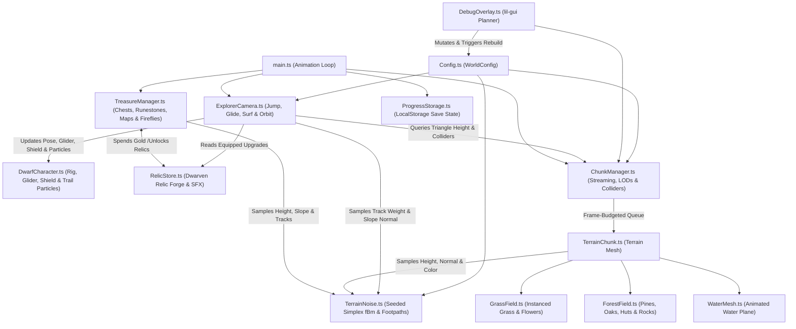

# Endless Procedural World

An endless, deterministic 3D procedural world adventure built with **TypeScript**, **Three.js**, **Simplex Noise**, and **Vite**. Explore sweeping hills, winding forest footpaths, meandering rivers, natural pond basins, wind-swept meadows, and airy forest groves as a traveling dwarf—complete with expressive traversal (jumping, valley wind-gliding, downhill shield-surfing), diegetic firefly treasure tracking, rune-sealed mythic chests, buried map hoards, and a **Dwarven Relic Forge**.

---

## How to Run

### Prerequisites
- **Node.js** (v18+ recommended) and **npm**

### 1. Install Dependencies
```bash
npm install
```

### 2. Start the Development Server
```bash
npm run dev
```
Vite will start a local development server (typically at `http://localhost:5173`) with Hot Module Replacement (HMR). Open the printed URL in your browser.

### 3. Build & Preview for Production
```bash
# Type-check with TypeScript and bundle for production into dist/
npm run build

# Locally preview the production build
npm run preview
```

---

## Controls

| Input | Action |
| :--- | :--- |
| **`W` `A` `S` `D`** or **Arrow Keys** | Move dwarf / camera relative to view direction |
| **`Shift`** (Hold) | Sprint (**+25% Trailblazer speed boost** on dirt footpaths, **+45%** with *Boots of the Strider*) |
| **`Space`** (Press / Hold in air) | **Jump** / **Double-Jump** (*Skyforge Greaves*) / Hold while descending to **Wind-Glide** across valleys |
| **`C`** or **`Ctrl`** (Press / Hold) | **Dodge-Dash** on flat ground or **Surf Downhill Slopes** on the *Ironbelly Surf-Shield* |
| **`1` `2` `3` `4`** | Unlock Dwarven Relics in the **Relic Forge** using collected Gold |
| **`B`** | Show / collapse the **Dwarven Relic Forge** HUD drawer |
| **Left / Right Mouse Drag** | Orbit camera around the dwarf |
| **Mouse Wheel** | Zoom camera in / out (`4m` – `45m`) |
| **`V`** | Toggle Camera Mode (`dwarf` third-person follow vs. `free` high-speed overview) |
| **`M`** | Toggle terrain wireframe rendering |
| **`P`** | Mute / unmute background music (*Wandering Through the Pines*) |
| **Top-Right GUI (`lil-gui`)** | Live-tune terrain noise, footpaths, water, forest groves, grass, wind, and reset saved progress |

---

## Architecture

The project is organized into modular subsystems under `src/`:

```text
procedural-world/
├── index.html                  # App shell & HUD overlay (Compass + Chest Pointer, Gold & Streak HUD, Relic Forge, Controls)
├── 3dmodels/                   # Close-range GLB assets (dwarf, pine, oak, dwarven hut, grass clump)
├── art/                        # Concept art & visual reference sheets
├── music/                      # Background soundtrack MP3
└── src/
    ├── main.ts                 # Entrypoint: Scene, renderer, lighting, shadow frustum tracking, HUD & main loop
    ├── style.css               # HUD, compass pointer, streak pill, Relic Forge drawer, and pickup toast styling
    ├── world/
    │   ├── Config.ts           # WorldConfig interface & default tuning parameters
    │   ├── TerrainNoise.ts     # Mulberry32 PRNG, multi-octave fBm noise, winding footpaths, river/pond carving, surface coloring
    │   ├── ChunkManager.ts     # Endless grid streaming, distance LODs, frame-budgeted build queue, O(1) collision & height queries
    │   ├── TerrainChunk.ts     # Individual chunk mesh builder, vertex coloring, seamless normals, child attachments
    │   ├── GrassField.ts       # GPU-instanced grass tufts & wildflowers with custom wind/push vertex shaders
    │   ├── ForestField.ts      # GPU-instanced pines, oaks, dwarven huts & shoreline boulders (close GLB + distant procedural LOD)
    │   ├── WaterMesh.ts        # Translucent animated ripple & caustic shader material for rivers and ponds
    │   ├── TreasureManager.ts  # Standard/Rare/Mythic chests, Standing Runestones, Buried Map Hoards, Guiding Fireflies & Streak Multiplier
    │   └── ProgressStorage.ts  # LocalStorage persistence for seed, player pose, gold, collected chests & unlocked relics
    ├── player/
    │   ├── DwarfCharacter.ts   # Animated 3D dwarf rig with deployable Wind-Glider, Surf-Shield, water wake rings & world-space trail particles
    │   └── RelicStore.ts       # Dwarven Relic Forge catalog, upgrade state, HUD shop & synthesized Web Audio SFX
    ├── controls/
    │   └── ExplorerCamera.ts   # Input handling, jump/glide/slope-surf physics, footpath speed boost & spherical orbit camera
    ├── ui/
    │   └── DebugOverlay.ts     # Live "World Planner" lil-gui panel for real-time world regeneration
    └── audio/
        └── BackgroundMusic.ts  # Looping background music controller with autoplay unlock & mute toggle
```

### System Data Flow



---

## Core Subsystems

### 1. Expressive Movement & Traversal (`ExplorerCamera.ts` & `DwarfCharacter.ts`)
- **Jump, Double-Jump & Wind Gliding (`Space`)**:
  - Full vertical velocity and gravity integration above the triangle-interpolated ground or water surface.
  - Holding `Space` while descending unfolds a 3D wooden-and-canvas **Dwarven Wind-Glider** above the dwarf's shoulders, reducing fall speed and boosting horizontal air speed to soar across valleys.
- **Downhill Slope Surfing & Dodge-Dash (`C` / `Ctrl`)**:
  - Pressing `C` or `Ctrl` triggers a snappy forward **Dodge-Dash** burst on flat ground.
  - Holding `C` or `Ctrl` on hillsides deploys the bronze **Ironbelly Surf-Shield** underfoot, aligning velocity with the terrain's steepest descent normal (`TerrainNoise.getNormal`) to accelerate down slopes up to `28.5 m/s` while kicking up golden sparks.
- **Trailblazer Footpath Boost**:
  - Walking or sprinting along the infinite winding dirt footpaths (`getTrackWeight > 0.35`) grants an automatic **+25% Trailblazer speed boost** (**+45%** with *Boots of the Strider*), emits world-space dust puffs from a zero-allocation ring buffer, and displays a live traversal status pill in the HUD (`⚡ Trailblazer Path`, `🪂 Wind Gliding`, `🛡️ Slope Surfing`).

### 2. Dwarven Relic Forge (`RelicStore.ts` & `ProgressStorage.ts`)
Players spend Gold earned from chests directly in the HUD **Dwarven Relic Forge** (via mouse click or hotkeys `1`–`4`, toggled with `B`). All unlocked relics persist automatically in `localStorage`:
- **`1` Boots of the Strider (`100 Gold`)**: +25% Sprint speed and +45% Trailblazer footpath speed boost.
- **`2` Skyforge Greaves & Glider (`150 Gold`)**: Higher jump, mid-air **Double-Jump**, and high-lift valley gliding.
- **`3` Ironbelly Surf-Shield (`200 Gold`)**: Turbo downhill slope-surfing acceleration/top speed (`28.5 m/s`) and extended dodge-dash.
- **`4` Lodestone Runes (`250 Gold`)**: Magnetically pulls nearby chests toward the dwarf (`8.5m` radius), grants **+50% bonus Gold** on all treasures, and unlocks a long-range golden **Compass Chest Pointer** (`▲`) on the HUD compass ring.

### 3. Treasure Hunting, Runestones, Buried Maps & Streaks (`TreasureManager.ts`)
- **Diegetic Firefly Guide Stream & Spatial Harmonic Hum**:
  - Instead of relying only on raw numbers, a stream of 26 glowing golden fireflies spawns near the player and swirls along the terrain toward the nearest active objective (up to `58m`, or `115m` with *Lodestone Runes*).
  - Approaching within `20m` of a treasure triggers a gentle, pitch-rising crystalline Web Audio resonance chime, while the HUD reports cardinal bearings and active puzzle states (`✨ 28m NE`, `🪨 Runes (1/3) • 16m NW`, `🗺️ Map Hoard: 54m SE`, `💎 Mythic: 31m E`).
- **Rune-Sealed Mythic Chests & Standing Runestones**:
  - Chunks can spawn **Mythic Runic Chests** (`+500 Gold` base) encased in a cyan runic barrier dome and surrounded by **3 Standing Dwarven Runestones** (`13m–20m` away).
  - Walking within `2.5m` of each Runestone awakens its floating crystal obelisk with a rising harmonic chord (`🪨 Runestone Awakened! (1/3)`). Awakening all 3 shatters the barrier dome so the Mythic Chest can be claimed.
- **Ancient Map Fragments & Buried Relic Hoards**:
  - Opening chests can reveal an **Ancient Treasure Map** (`🗺️ Map Found! Buried Hoard 64m NE!`), spawning a **Buried Dwarven Hoard** (`+400 Gold` base) marked by a pulsing crimson-gold dig circle and a vertical sky light beam.
- **Gold Streak Combo Multiplier**:
  - Chaining chest pickups or buried hoards within a **45-second window** builds a **Gold Streak Multiplier** (`1.25x` → `1.5x` → `2.0x` → `2.5x`) shown in the `#streak-badge` HUD pill (`🔥 2.0x Streak`), multiplying all gold earned.

### 4. Deterministic Multi-Scale Terrain & Footpaths (`TerrainNoise.ts`)
- **Seeded PRNG (`createSeededRandom`)**: Uses **Mulberry32** so any integer seed produces a repeatable world.
- **Multi-Layered Simplex Noise**: Combines domain warping, 2-octave macro hills with valley flattening, 3-octave ridged/smooth meso knolls, and 2-octave micro contours.
- **Infinite Winding Forest Tracks**: Evaluates phase-steered primary and secondary footpaths (`getTrackDistance`, `getTrackWeight`) that gently grade the terrain trough, raise mossy root shoulders, clear trees from the walking bed, and color the soil with mottled sandy loam and gravel patches.
- **Hydrology Carving**: Carves meandering river valleys and calm pond basins below `waterLevel`, with seamless central finite-difference normals across chunk borders.

### 5. Endless Chunk Streaming & GPU-Instanced Flora (`ChunkManager.ts`, `GrassField.ts`, `ForestField.ts`, `WaterMesh.ts`)
- **Circular Grid Streaming & Frame-Budgeted Queue**: Streams chunks within `renderRadius` around the player and builds at most `maxChunksPerFrame` per frame with distance-tiered terrain segment and grass density LODs.
- **Close-Range GLB + Distant Procedural LODs**: Renders detailed GLB models for nearby pines, oaks, dwarven huts, and grass clumps while seamlessly switching distant chunks to lightweight procedural instanced meshes.
- **Exact Triangle Surface Interpolation & O(1) Colliders**: Interpolates exact rendered triangle heights beneath the dwarf's boots and resolves 2D circle-circle collisions against nearby trees, huts, and boulders with zero heap allocations.
