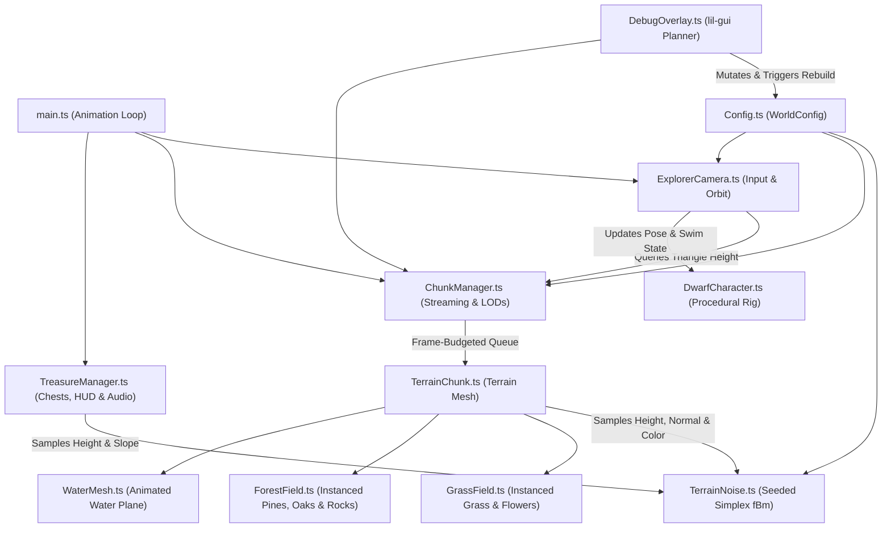

# Endless Procedural World

An endless, deterministic 3D procedural world explorer built with **TypeScript**, **Three.js**, **Simplex Noise**, and **Vite**. Explore sweeping hills, meandering rivers, natural pond basins, wind-swept meadows, and airy forest groves as a stylized traveling dwarf collecting hidden dwarven treasure chests.

---

## How to Run

### Prerequisites
- **Node.js** (v18+ recommended) and **npm**

### 1. Install Dependencies
```bash
npm install
```

### 2. Start the Development Server
```bash
npm run dev
```
Vite will start a local development server (typically at `http://localhost:5173`) with Hot Module Replacement (HMR). Open the printed URL in your browser.

### 3. Build & Preview for Production
```bash
# Type-check with TypeScript and bundle for production into dist/
npm run build

# Locally preview the production build
npm run preview
```

---

## Controls

| Input | Action |
| :--- | :--- |
| **`W` `A` `S` `D`** or **Arrow Keys** | Move dwarf / camera relative to view direction |
| **`Shift`** (Hold) | Sprint |
| **Left / Right Mouse Drag** | Orbit camera around the dwarf |
| **Mouse Wheel** | Zoom camera in / out (`4m` – `45m`) |
| **`V`** | Toggle Camera Mode (`dwarf` third-person follow vs. `free` high-speed overview) |
| **`M`** | Toggle terrain wireframe rendering |
| **`P`** | Mute / unmute background music (*Wandering Through the Pines*) |
| **Top-Right GUI (`lil-gui`)** | Live-tune terrain noise, water, forest groves, grass, wind, and debug settings |

---

## Architecture

The project is organized into modular subsystems under `src/` with zero external runtime asset dependencies required for 3D geometry (all terrain, flora, character parts, and chests are procedurally constructed on the fly):

```text
procedural-world/
├── index.html                  # App shell & HUD overlay (Compass, Gold Score, Coords, Controls)
├── art/                        # Concept art & visual reference sheets
├── music/                      # Background soundtrack MP3
└── src/
    ├── main.ts                 # Entrypoint: Scene, renderer, lighting, shadow frustum tracking, main loop
    ├── style.css               # HUD, compass, pickup toast, and responsive overlay styling
    ├── world/
    │   ├── Config.ts           # WorldConfig interface & default tuning parameters
    │   ├── TerrainNoise.ts     # Mulberry32 PRNG, multi-octave fBm noise, river/pond carving, surface coloring
    │   ├── ChunkManager.ts     # Endless grid streaming, distance LODs, frame-budgeted build queue, triangle height queries
    │   ├── TerrainChunk.ts     # Individual chunk mesh builder, vertex coloring, seamless normals, child attachments
    │   ├── GrassField.ts       # GPU-instanced 5-blade grass tufts & wildflowers with custom wind/push vertex shaders
    │   ├── ForestField.ts      # GPU-instanced pine trees, broadleaf oaks, and mossy shoreline boulders
    │   ├── WaterMesh.ts        # Translucent animated ripple & caustic shader material for rivers and ponds
    │   └── TreasureManager.ts  # Deterministic per-chunk chest spawning, proximity pickup, particle bursts & Web Audio chime
    ├── player/
    │   └── DwarfCharacter.ts   # Procedural 3D dwarf rig with walking/hiking stride and buoyant swimming animations
    ├── controls/
    │   └── ExplorerCamera.ts   # Input handling, spherical orbit camera, terrain anti-clipping & land/water transitions
    ├── ui/
    │   └── DebugOverlay.ts     # Live "World Planner" lil-gui panel for real-time world regeneration
    └── audio/
        └── BackgroundMusic.ts  # Looping background music controller with autoplay unlock & mute toggle
```

### System Data Flow



---

## Core Subsystems

### 1. Deterministic Multi-Scale Terrain (`TerrainNoise.ts`)
- **Seeded PRNG (`createSeededRandom`)**: Uses **Mulberry32** so any integer seed produces the exact same world layout.
- **Multi-Layered Simplex Noise**:
  - **Domain Warping**: Offsets $(x, z)$ coordinates organically before sampling so ridges and rivers never align to a grid.
  - **Macro Layer (2 octaves)**: Broad sweeping hills and valleys, with configurable valley-floor flattening (`valleyFlatten`) for natural meadow basins.
  - **Meso Layer (3 octaves)**: Blended ridged and smooth noise for local knolls and rolling ridges.
  - **Micro Layer (2 octaves)**: Subtle ground contours.
- **Hydrology Carving**:
  - **Meandering Rivers**: Uses the zero-crossing of domain-warped Simplex noise (`|riverNoise|`) with variable width modulation to grade surrounding hills into a gentle river valley and carve a wet channel below `waterLevel`.
  - **Natural Pond Basins**: Depresses low-to-mid elevation valleys into calm ponds where `pondNoise` exceeds a threshold.
- **Seamless Normals & Vertex Palette**: Computes central finite-difference surface normals (`getNormal`) in world space so adjacent chunks have zero lighting seams, even across different LOD resolutions. Colors vertices dynamically based on meadow patches, forest shade, elevation, slope steepness (earthy dirt on cliffs), sandy shore banks, and wet riverbeds.

### 2. Endless Chunk Streaming & LODs (`ChunkManager.ts` & `TerrainChunk.ts`)
- **Circular Grid Streaming**: Maintains active chunks within `renderRadius` (default `6` chunks = `13×13` grid of `48m × 48m` chunks) around the player.
- **Frame-Budgeted Queue**: Sorts pending chunk requests nearest-first and builds at most `maxChunksPerFrame` (default `3`) per animation frame to prevent frame drops while moving.
- **Distance-Based Geometry & Grass LOD**:
  - **Inner Ring (`dist <= 2.2` chunks)**: `64×64` terrain grid segments, `100%` 3D grass density (`2,600` tufts/chunk).
  - **Mid Ring (`dist <= 4.2` chunks)**: `32×32` terrain grid segments, `55%` 3D grass density within `grassRadiusChunks`.
  - **Outer Ring (`dist > 4.2` chunks)**: `20×20` terrain grid segments, vertex-colored terrain + instanced trees.
- **Exact Triangle Surface Interpolation (`getSurfaceHeight`)**: Matches `THREE.PlaneGeometry`'s diagonal quad split to interpolate the exact rendered triangle height beneath the player and camera, preventing boots from sinking into concave slopes.

### 3. GPU-Instanced Flora & Custom Shaders (`GrassField.ts`, `ForestField.ts`, `WaterMesh.ts`)
- **3D Grass & Wildflowers (`GrassField.ts`)**:
  - Shares a single 5-blade curved ribbon tuft `BufferGeometry` and a wildflower cluster geometry across all chunks via `THREE.InstancedMesh`.
  - Injects custom GLSL into `MeshStandardMaterial.onBeforeCompile` for rolling wind waves, root-to-tip ambient occlusion / sunlit tinting, smooth distance fade-out at the outer grass radius, and interactive radial blade push-away around the dwarf.
- **Forest Groves & Shoreline Rocks (`ForestField.ts`)**:
  - Procedurally merges vertex-colored geometries for 5-tier **Pine/Spruce conifers**, multi-lobe **Broadleaf/Oak trees**, and **mossy shoreline boulders**.
  - Uses a jittered `5×5` cell grid per chunk (`9.6m` cells) modulated by `getForestDensity` so trees form airy groves with natural open meadow clearings and never overlap.
- **Water Surface (`WaterMesh.ts`)**:
  - Adds a shared water plane only to chunks whose minimum elevation dips below `waterLevel`, animated in GLSL with dual sine/cosine surface waves and caustic color shimmer.

### 4. Player Rig, Swimming & Camera (`DwarfCharacter.ts` & `ExplorerCamera.ts`)
- **Procedural Dwarf Proxy**: Built from hierarchical `THREE.Group` nodes (boots, tunic, belt, backpack with bedroll, bearded head with pointed traveler hat, arms, and walking staff).
- **Land & Water Locomotion**: Automatically transitions between a rhythmic hiking stride on land and a buoyant breaststroke/flutter-kick swimming posture (complete with expanding water wake rings and a stowed walking staff) when entering rivers or ponds deeper than `0.38m`.
- **Shadow Frustum Tracking**: In `main.ts`, the directional sunlight's orthographic shadow camera follows the player every frame so high-resolution `2048×2048` soft shadows remain crisp regardless of how far you travel from `(0, 0)`.

### 5. Treasure Hunt & Audio (`TreasureManager.ts` & `BackgroundMusic.ts`)
- **Deterministic Chest Spawning**: Spawns standard (`+100 Gold`) and rare crimson-gold (`+250 Gold`) dwarven chests on dry, gentle slopes using per-chunk seeded RNG, remembering collected chest IDs across chunk unloads.
- **Interactive Feedback**: Walking within `1.95m` of a chest swings its hinged lid open, triggers a 3D gold particle burst, updates the HUD score and nearest-chest distance tracker, and synthesizes a multi-note pickup chime via the browser's **Web Audio API**.
