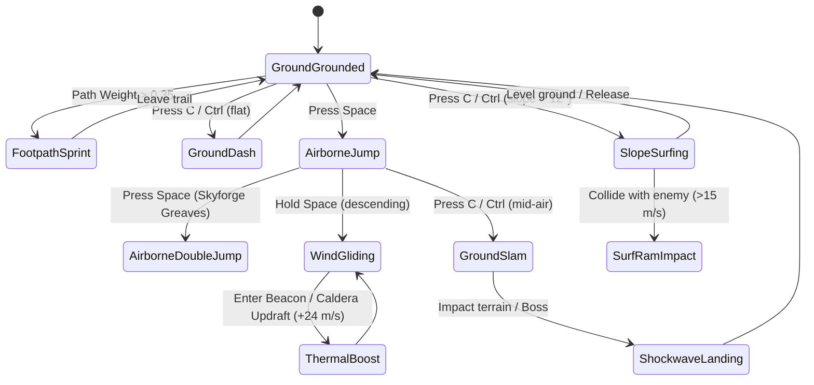
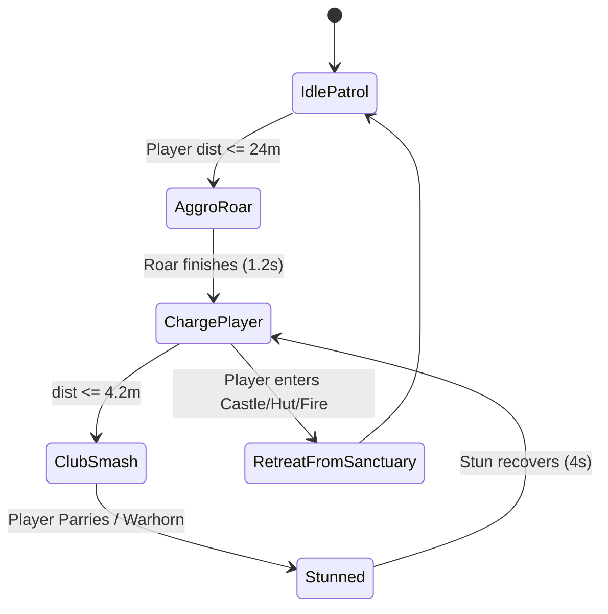
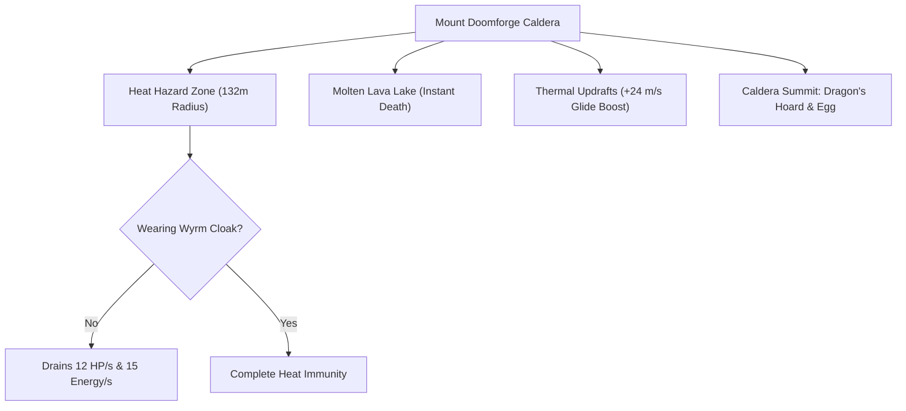
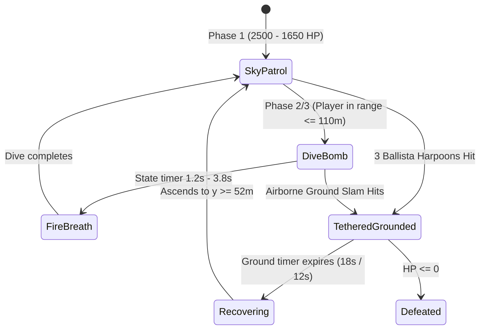
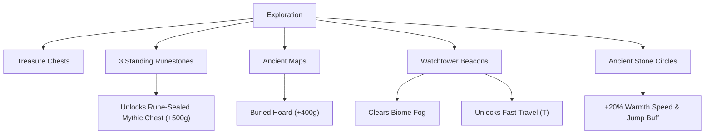

# The Wandering Dwarf: Complete Gameplay & Systems Guide

> A comprehensive, definitive manual detailing all gameplay systems, traversal mechanics, combat formulas, economic loops, crafting and masonry, world bosses, and architectural complexities within the infinite procedural world of ***Wandering Dwarf***.

---

## Table of Contents
1. [Core Architecture & World Simulation](#1-core-architecture--world-simulation)
2. [Master Keybindings & Control Matrix](#2-master-keybindings--control-matrix)
3. [Dwarf Character Physics & Traversal Mechanics](#3-dwarf-character-physics--traversal-mechanics)
4. [The Dwarven Economy, Renown & Progression Loops](#4-the-dwarven-economy-renown--progression-loops)
5. [Dwarven Relic Forge & House Equipment](#5-dwarven-relic-forge--house-equipment)
6. [Masonry, Quarries & Castle Fortification](#6-masonry-quarries--castle-fortification)
7. [Weapons, Melee Combat & Shield Defense](#7-weapons-melee-combat--shield-defense)
8. [Backpack Bow Hunting & Wildlife Ecology](#8-backpack-bow-hunting--wildlife-ecology)
9. [Backpack Fishing & Aquatic Simulation](#9-backpack-fishing--aquatic-simulation)
10. [Troll Ecology, Goblins & Night Invasions](#10-troll-ecology-goblins--night-invasions)
11. [Mount Doomforge Caldera & Environmental Hazards](#11-mount-doomforge-caldera--environmental-hazards)
12. [World Bosses & Dynamic World Events](#12-world-bosses--dynamic-world-events)
    - [Vermithrax the Smoldering (Dragon Boss)](#vermithrax-the-smoldering-dragon-boss)
    - [The Crag-Titan World Boss](#the-crag-titan-world-boss)
    - [Celestial Star-Metal Meteorites](#celestial-star-metal-meteorites)
    - [Dwarven Underground Mines & Light-Beam Puzzle](#dwarven-underground-mines--light-beam-puzzle)
13. [Landmarks, Exploration & World Navigation](#13-landmarks-exploration--world-navigation)
14. [Save State Architecture & Data Persistence](#14-save-state-architecture--data-persistence)

---

## 1. Core Architecture & World Simulation

*Wandering Dwarf* is powered by a custom procedural Three.js WebGL engine running zero-allocation main simulation loops. The world is seeded deterministically and streamed infinitely across a circular chunk grid.

```mermaid
flowchart TD
    Engine["main.ts (60 FPS Simulation Loop)"]
    TerrainNoise["TerrainNoise.ts (Seeded Simplex fBm & Ridge Formations)"]
    ChunkMgr["ChunkManager.ts (Circular Grid Streaming & LODs)"]
    Explorer["ExplorerCamera.ts (Airborne, Slope & Traversal Physics)"]
    Dwarf["DwarfCharacter.ts (Skeletal Rig, Bone Sockets & Equipment)"]
    Combat["TrollCombatManager.ts (Melee, Combos, Parries & Sieges)"]
    Castle["CastleAndQuarryManager.ts (Masonry, Hauling & Ballistae)"]
    Events["DynamicWorldEventManager.ts (Dragon, Titan & Meteors)"]
    Relics["RelicStore.ts (Upgrades & Web Audio Synthesis)"]
    Progression["AssignmentManager.ts (Ranks, Decrees & Contracts)"]

    Engine --> Explorer
    Engine --> ChunkMgr
    Engine --> Combat
    Engine --> Castle
    Engine --> Events
    Explorer -->|O(1) Triangle Surface Height & Colliders| ChunkMgr
    Explorer --> Dwarf
    Combat --> Dwarf
    Castle --> Dwarf
    Combat <--> Relics
    Progression <--> Combat
    Progression <--> Castle
```

### Key Technical Pillars
* **Decoupled Level of Detail (LOD)**: High-resolution `.glb` models (`heavy ballista`, `deer`, `dwarf`, `fantasy goblin`, `troll-beast`) load within close visual distance ($\le 0.9$ to $1.5$ chunks). Beyond this threshold, models seamlessly revert to optimized procedural merged buffers.
* **Exact Triangle Interpolation**: Ground contact physics interpolate barycentric triangle coordinates directly from vertex buffers in $O(1)$ time, guaranteeing that the dwarf, dropped boulders, deer, and chests never clip through uneven ground.
* **Single Exterior Light Budget**: Interior stages enforce `NUM_POINT_LIGHTS = 1`, preserving strict WebGL uniform budgets and 60 FPS performance across lower-end devices.

---

## 2. Master Keybindings & Control Matrix

| Key / Input | Action | Context & Behavior |
| :--- | :--- | :--- |
| **`W` `A` `S` `D`** | Move / Steer | Standard directional locomotion; steers glide direction in air. |
| **`Shift` (Hold)** | Sprint | Increases run speed; drains Energy/Stamina over time. |
| **`Space`** | Jump / Double-Jump | Leaps off ground; triggers mid-air Double-Jump if *Skyforge Greaves* are equipped. |
| **`Space` (Hold mid-air)** | Dwarven Wind-Glider | Unfolds shoulder glider canvas; provides horizontal glide lift and catches updrafts. |
| **`C` / `Ctrl` (On slope)** | Ironbelly Surf-Shield | Mounts shield underfoot; surfs terrain gradients up to **28.5 m/s** with sparks. |
| **`C` / `Ctrl` (Flat ground)** | Dodge-Dash | Rapid forward evasion dash with invulnerability frames. |
| **`C` / `Ctrl` (In mid-air)** | Airborne Ground Slam | Shield-plunge downwards; triggers landing shockwave or mounts boss crests. |
| **`Left-Click`** | Primary Strike / Fire | Swings equipped melee weapon; fires arrow in Hunting mode; casts rod in Fishing mode. |
| **`Right-Click` / `Z`** | Shield Block / Parry | Raises equipped shield to deflect Troll smashes, goblin bombs, and dragon fire. |
| **`H`** | Toggle Hunting Bow | Draws/stows 3D recurve bow; activates ballistic aiming arc and bullet-time zoom. |
| **`F`** | Toggle Fishing Rod | Draws/stows 3D fishing rod along rivers, lakes, and oceans. |
| **`Q`** | Establish Quarry | Stakes a stone quarry near natural rock boulders. |
| **`K`** | Stake Castle Site | Designates a new castle foundation on level ground. |
| **`E`** | Interact / Delve / Haul | Gathers boulders, deposits stone blocks, enters Huts/Castles, claims artefacts. |
| **`U`** | Upgrade Quarry | Upgrades active Quarry to Tier II Steam Automaton Quarry (300g). |
| **`B` (In field)** | Toggle Relic Forge | Opens HUD shop to purchase Relics 1–4. |
| **`B` (Outside Castle)** | Summon Castle Siege | Summons a 3-Troll Blood-Moon Siege Wave outside your gate drawbridge. |
| **`V`** | Warhorn of Khazad | Sounds warhorn to stun surrounding Trolls and rally strength (unlocked at Rank II). |
| **`T`** | Fast Travel / Temper Anvil | Warps to nearest lit Beacon, or tempers weapon when standing at Castle Runic Anvil. |
| **`M`** | Toggle World Map | Displays fullscreen parchment map with fog of war, waypoints, and markers. |
| **`N`** | Advance Time of Day | Cycles day phases: Dawn $\rightarrow$ Midday $\rightarrow$ Sunset $\rightarrow$ Starry Night. |
| **`1` – `4`** | Buy Relics 1–4 | Quick-purchase hotkeys for Dwarven Relic Forge upgrades. |
| **`5` – `8` (In Hut)** | Buy House Tools | Purchases Mason's Chisel, Stone-Hauler Cart, Ration Kettle, Architect's Pulley. |
| **`5` – `9`, `0` (In Castle)** | Armory & Provisions | Forges weapons, shields, thermal cloaks, and feasts inside Castle Halls. |

---

## 3. Dwarf Character Physics & Traversal Mechanics



### 1. Trailblazer Footpaths
* Infinite procedural dirt tracks wind through the wilderness (`TerrainNoise.getTrackWeight > 0.35`).
* Walking or sprinting along footpaths grants an automatic **+25% speed bonus** (**+45%** with *Boots of the Strider*).
* Zero-allocation particle buffers kick up continuous dust puffs behind the dwarf's boots.

### 2. Spring Greaves & Skyforge Gliding
* **Base Jump Velocity:** $v_y = 8.5\text{ m/s}$ ($10.8\text{ m/s}$ with *Spring Greaves*).
* **Double-Jump:** Mid-air jump adds $+9.8\text{ m/s}$ upward impulse.
* **Wind-Glider Canvas:** Holding `Space` while descending caps terminal falling velocity at $-3.2\text{ m/s}$ while boosting horizontal glide speed to $16.5\text{ m/s}$.
* **Thermal Updrafts:** Gliding through Watchtower Beacon sky-beams or volcanic caldera vents launches the dwarf vertically at **$+24.0\text{ m/s}$**.

### 3. Ironbelly Slope-Surfing & Shield-Ramming
* Deploying the bronze surf-shield on slopes steeper than $12^\circ$ aligns movement with the negative terrain gradient $\nabla h(x, z)$.
* Terminal velocity reaches **$28.5\text{ m/s}$**, producing grinding sparks and trail ribbons.
* Striking any enemy at $>15.0\text{ m/s}$ executes a **High-Speed Surf-Ram**, dealing $65\text{ damage}$ and staggering the target.

### 4. Airborne Ground Slam & Shockwave
* Pressing `C` or `Ctrl` while airborne ($h > 0.65\text{m}$) commands the dwarf to plunge downward at $-27.0\text{ m/s}$ ($-32.0\text{ m/s}$ with shield).
* Landing produces a radial shockwave ($8.0\text{m}$ radius) dealing $80\text{ damage}$ and knocking back nearby enemies.
* Directly hitting a World Boss (such as Vermithrax or the Crag-Titan) triggers a **Heroic Mount Slam** dealing massive critical multiplier damage.

### 5. Two-Handed Heavy Hauling
* Picking up raw granite boulders or chiseled blocks shifts the skeletal rig into an anchored two-handed carry posture.
* Base carry capacity: 1 raw stone or 1 chiseled block (upgrades to 3 stones / 4 blocks with the *Dwarven Stone-Hauler Cart*).

---

## 4. The Dwarven Economy, Renown & Progression Loops

The gameplay loop connects exploration, extraction, construction, and combat through three core resources: **Gold (🪙)**, **Food Rations (🍖)**, and **Renown XP (🎖️)**.

### Dwarven Rank Progression (`DWARVEN_RANKS`)


| Rank & Title | Required Renown | Stat Bonuses | Special Perks & Unlocks |
| :--- | :--- | :--- | :--- |
| **I. Outcast Prospector** | 0 🎖️ | Base Stats (100 HP / 100 Energy) | Starter pickaxe & prospecting gear. |
| **II. Master Stonemason** | 200 🎖️ | +15❤️ / +15⚡, +12% DMG | Unlocks Horned Helmet & **Warhorn of Khazad (`V`)**. |
| **III. Stronghold Warden** | 500 🎖️ | +35❤️ / +30⚡, +25% DMG | Mithril Pauldrons; bow deals full damage to Trolls. |
| **IV. Runesmith & Thane** | 950 🎖️ | +55❤️ / +45⚡, +40% DMG | +22% Heavy Haul speed; unlocks advanced anvil tempering. |
| **V. High King of the Mountain** | 1,500 🎖️ | +80❤️ / +65⚡, +60% DMG | Golden Crown; passive royal regeneration (+1.2 HP/s). |
| **VI. Lord of the Iron Citadel** | 2,200 🎖️ | +115❤️ / +90⚡, +85% DMG | +38% Haul speed; unlocks Blood-Moon Castle Sieges. |
| **VII. Dragon-Slayer Regent** | 3,400 🎖️ | +155❤️ / +125⚡, +115% DMG | Dragon-Bane Strike; +46% Haul speed; Dragon Greataxe. |
| **VIII. Immortal Ancestor** | 4,800 🎖️ | +200❤️ / +165⚡, +150% DMG | Ancestral Aegis; permanent 2.0× baseline Gold streak floor. |

### Warhorn of Khazad (`V`)
* **Unlock Condition:** Reaching Rank II or owning any weapon/shield.
* **Combat Effect:** Blasts an ancestral horn sound that stuns all Trolls and Goblins within a $14.0\text{m}$ radius for $4.5\text{ seconds}$.
* **Rally Buff:** Grants $+30\%$ movement speed and $+25\%$ melee attack damage for $12\text{ seconds}$. Cooldown: $45\text{ seconds}$.

### Royal Chronicle Decrees (Chapters 1–18)
1. **Ch. 1 — Awakening on the Frontier:** Open 2 chests or light 1 Watchtower Beacon (+45g, +80🎖️).
2. **Ch. 2 — Tools of the Ancestors:** Unlock 1 Relic or 1 House Tool (+60g, +90🎖️).
3. **Ch. 3 — Sacred Hearth Delve:** Enter a Dwarven Hut and attune 1 Sacred Artefact (+80g, +110🎖️).
4. **Ch. 4 — Strike the Living Rock:** Build a Quarry and chisel 2 Castle Blocks (+95g, +120🎖️).
5. **Ch. 5 — Raise the Border Keep:** Deliver 8 blocks to complete a Tier I Keep (+130g, +150🎖️).
6. **Ch. 6 — Steel & Oak of the Armory:** Forge 1 weapon and 1 shield in your Castle (+110g, +130🎖️).
7. **Ch. 7 — Trial of Dwarven Valor:** Slay 1 Night Troll or complete 1 Ring Trial (+150g, +160🎖️).
8. **Ch. 8 — Bounty of Forest & Fjord:** Harvest 3 wild game or fish (+140g, +150🎖️).
9. **Ch. 9 — Stonewall Stronghold:** Expand a Castle to 18 blocks (+190g, +200🎖️).
10. **Ch. 10 — Keeper of the Sacred Relics:** Collect 3 Sacred Artefacts (+210g, +220🎖️).
11. **Ch. 11 — Mountain King's Grand Citadel:** Deliver 30 blocks for a Tier III Citadel (+300g, +300🎖️).
12. **Ch. 12 — Legend of Khazad-dûm:** Attune 5 Artefacts and slay 3 Trolls (+450g, +400🎖️).
13. **Ch. 13 — Tempered in Runefire:** Temper weapon to +1 on Castle Runic Anvil (+260g, +260🎖️).
14. **Ch. 14 — Siege of the Iron Citadel:** Repel a Blood-Moon Siege wave (+500g, +450🎖️).
15. **Ch. 15 — Master of the Wind & Slope:** Catch a thermal updraft or perform a surf-ram (+320g, +320🎖️).
16. **Ch. 16 — The Automated Realm:** Upgrade a Quarry to Steam Automaton (+380g, +360🎖️).
17. **Ch. 17 — Strike the Mithril Crags:** Mine 2 high-altitude Mithril Ore Veins (+450g, +420🎖️).
18. **Ch. 18 — Citadel Crown:** Deliver 30 blocks or temper weapon to +3 (+650g, +600🎖️).
* **Grand Finale Decree:** Slay Vermithrax the Smoldering or plunder the Dragon Egg (+1,500g, +1,200🎖️).

### Dynamic Guild Contracts
Players can cycle contracts anytime: Masonry Blocks, Chisel Stones, Hunt Deer, Catch Fish, Slay Trolls, or Open Chests. Completing targeted quotas yields scaling gold, renown, and food rations.

---

## 5. Dwarven Relic Forge & House Equipment

### The Relic Forge (`RelicStore.ts` — Keys `1`–`4`, Toggle with `B`)
* **`1` Boots of the Strider (100g):** $+25\%$ Sprint speed; increases footpath Trailblazer boost from $+25\%$ to $+45\%$.
* **`2` Skyforge Greaves & Glider (150g):** Unlocks mid-air **Double-Jump** and high-lift wind gliding.
* **`3` Ironbelly Surf-Shield (200g):** Enables downhill slope-surfing ($28.5\text{ m/s}$ top speed) and extended dodge-dashing.
* **`4` Lodestone Runes (250g):** Magnetically pulls chests within $8.5\text{m}$, awards $+50\%$ bonus gold on treasures, and unlocks compass chest pointers.

### Dwarven Hut Equipment (`CastleAndQuarryManager.ts` — Keys `5`–`8` inside Huts)
* **`5` Tungsten Mason's Chisel (150g):** Chisels 2 blocks per stone, cuts twice as fast, $-40\%$ energy cost.
* **`6` Dwarven Stone-Hauler Cart (200g):** Increases carry capacity to 3 raw stones or 4 chiseled blocks with zero heavy encumbrance slowdown.
* **`7` Ironbelly Ration Kettle (175g):** Increases Max Energy from 100 to 160; $+50\%$ food recovery efficiency; $+1$ bonus ration per fish/deer.
* **`8` Royal Architect's Pulley Rig (275g):** Places 2 castle blocks simultaneously; linked quarries automatically cut 1 block every 18 seconds.

### Sacred Dwarven Artefacts (`ARTEFACT_CATALOG` inside Huts)
* **Crown of Durin's Peak:** $+25\%$ gold from all sources; unlocks royal cosmetic crown.
* **Runesmith's Astral Hammer:** $35\%$ chance to chisel $+1$ free bonus castle block.
* **Chalice of the Mountain King:** $+35\%$ health and energy restored from all food.
* **Heartstone of the Deep:** Passively regenerates $+1.0\text{ HP}$ and $+2.5\text{ Energy}$ every second.
* **Ancient Runic Tablet:** $+35\%$ bonus Renown XP from all decrees and contracts.
* **Aegis of the Iron Hills:** $-20\%$ incoming Troll smash damage; widens shield parry window.

---

## 6. Masonry, Quarries & Castle Fortification

```mermaid
flowchart LR
    Rock["Natural Rock Boulders"] -->|Gather E| Haul["Carry Stone to Quarry"]
    Haul -->|Chisel E / Tungsten Chisel| Blocks["Chiseled Castle Blocks"]
    Blocks -->|Hauler Cart E| CastleSite["Castle Construction Site (K)"]
    CastleSite -->|Deliver 8 Blocks| Tier1["Tier I: Border Keep (1 Turret)"]
    Tier1 -->|Deliver 18 Blocks| Tier2["Tier II: Stonewall Stronghold (3 Turrets)"]
    Tier2 -->|Deliver 30 Blocks| Tier3["Tier III: Grand Citadel (4 Turrets)"]
```



### 1. Stone Extraction & Chisel Stations
* Natural rock boulders populate the terrain. Pressing **`E`** lifts a boulder.
* Pressing **`Q`** establishes a Stone Quarry complete with crane, tool rack, and chisel workbench.
* Interacting with the workbench chips raw stones into precision **Chiseled Castle Blocks**.

### 2. Steam Automaton Quarry Upgrade (`U`)
* Upgrading a quarry (300g) deploys an autonomous dwarven steam automaton (`3dmodels/dwarven steam automaton 3d model.glb`).
* The automaton continuously hammers raw stone and deposits chiseled blocks onto a conveyor without player intervention.

### 3. Castle Construction Tiers (`K`)
Staking a site on level terrain establishes foundations across 3 distinct architectural milestones:

| Milestone Tier | Blocks Required | Structure Type | Defenses & Amenities |
| :--- | :--- | :--- | :--- |
| **Tier I** | 8 Blocks | **Dwarven Border Keep** | 1 Automated Roof Ballista, drawbridge, gatehouse, hearth stew. |
| **Tier II** | 18 Blocks | **Stonewall Stronghold** | 3 Automated Roof Ballistae, twin battlements, armory, roast boar feast. |
| **Tier III** | 30 Blocks | **Mountain King's Grand Citadel** | 4 Automated Roof Ballistae, golden spire, throne room, Runic Anvil. |

### 4. Automated Roof-Mounted Ballista Turrets
* Modeled using `3dmodels/heavy ballista 3d model.glb` ($19,970\text{ triangles}$ with close-range LOD optimization).
* Turrets autonomously scan a $36.0\text{m}$ ground perimeter for Night Trolls and a **$65.0\text{m}$ aerial cone** for dragons.
* Fires pooled 3D Runic Siege Bolts every $2.15\text{ seconds}$, staggering ground enemies and attaching harpoon tethers to airborne dragons.

### 5. Blood-Moon Troll Siege Defense
* Pressing **`B`** outside a completed castle summons a siege wave of 3 armored Trolls marching upon your gate.
* Defending the gate alongside your roof ballistae rewards **$+450\text{ Gold}$**, **$+5\text{ Food Rations}$**, and **$+250\text{ Renown}$**.

---

## 7. Weapons, Melee Combat & Shield Defense

Combat combines fast melee strikes, directional parrying, weapon tempering, and special abilities.

```mermaid
graph TD
    Attack["Left-Click Strike"] --> HitBox{"Target in Range?"}
    HitBox -->|Troll <= 6.5m| MeleeDamage["Apply Weapon DMG * Rank Multiplier"]
    HitBox -->|No| Miss["Air Swing"]
    TrollAttack["Troll Club Smash"] --> Defend{"Holding Right-Click / Z?"}
    Defend -->|Yes (Within 0.4s)| Parry["Perfect Parry: Stagger Troll + Deflect 85% DMG"]
    Defend -->|Yes (Standard)| Block["Block: Absorb 70-85% DMG"]
    Defend -->|No| HeavyHit["Full DMG (30-45 HP) + Knockback"]
```

### Castle Armory Catalog

| Item Name | Type | Min Castle Tier | Cost | Damage / HP | Combat Mechanics & Description |
| :--- | :--- | :--- | :--- | :--- | :--- |
| **Iron-Studded Oak Club** | Weapon | Tier I | 120g | 22 DMG | Heavy blunt stagger; takes 15 strikes to fell a standard Troll. |
| **Bearded Battle-Axe** | Weapon | Tier I | 220g | 30 DMG | Cleaving arc strikes; 11 strikes to fell a standard Troll. |
| **Stonewall Broadsword** | Weapon | Tier II | 360g | 40 DMG | Fast recovery; balanced blade; 8 strikes to fell a Troll. |
| **Runic Greatsword** | Weapon | Tier III | 550g | 55 DMG | Golden Runic Shockwave on strike; 6 strikes to fell a Troll. |
| **Dragon-Slayer Greataxe** | Weapon | Tier III | 850g | 85 DMG | Hold `Left-Click` ($20⚡$) to unleash a **Whirlwind Spin Cleave**. |
| **Iron-Boss Round Shield** | Shield | Tier I | 160g | +25 HP | Blocks 70% incoming Troll damage; deflects boulders. |
| **Runic Mithril Aegis** | Shield | Tier II | 340g | +50 HP | Blocks 85% damage; parrying staggers attacking Trolls. |
| **Wyrm-Scale Thermal Cloak**| Cloak | Tier II | 450g | Immunity | Total immunity to Mount Doomforge Caldera heat drain. |

### Runic Anvil Weapon Tempering (`T`)
Inside any completed castle, stepping into the glowing purple anvil circle allows players to temper their equipped weapon:
* **Level +1 (200g):** $+15\%$ weapon damage.
* **Level +2 (400g):** $+30\%$ weapon damage + purple flame trail.
* **Level +3 (750g):** $+50\%$ weapon damage + explosive runic strike bursts.

---

## 8. Backpack Bow Hunting & Wildlife Ecology

### 1. Equipment & Aiming Mechanics (`H`)
* Pressing **`H`** draws the 3D recurve bow and quiver from the backpack.
* Moving the mouse projects an exact 3D ballistic trajectory arc accounting for gravitational drop.
* When aiming in mid-air or near targets, **Bullet-Time Slow Motion** engages, narrowing FOV ($50^\circ \rightarrow 42^\circ$) for precision shots.
* Reticle locks onto deer, trolls, goblins, titans, and dragon weak points.
* **Left-Click** or **`Space`** discharges a pooled physical 3D arrow.

### 2. Wild Deer Species (`3dmodels/deer 3d model.glb`)
Herds graze organically across meadows and clearings. Approaching within $14\text{m}$ spooks the herd, causing deer to bound away over ridges.

* **Woodland Stag:** $+150\text{ Gold}$, $+2\text{ Food Rations}$.
* **Redwood Buck:** $+185\text{ Gold}$, $+3\text{ Food Rations}$.
* **Royal Golden-Horn Stag:** $+280\text{ Gold}$, $+5\text{ Food Rations}$, $+100\text{ Renown}$.

---

## 9. Backpack Fishing & Aquatic Simulation

### 1. Equipment & Casting (`F`)
* Approaching any shoreline and pressing **`F`** equips the 3D telescopic fishing rod.
* Aim with the mouse or movement keys up to $18.0\text{m}$ out onto the water surface.
* **Left-Click** casts the red-and-white bobber onto the planar reflective water surface.

### 2. Water Shader & Visual Acoustics
* Water is rendered using a real-time planar mirror reflection pass reflecting the dwarf, terrain, and sky while maintaining natural transparency to reveal underwater schools.
* Entering or wading into water spooks fish, sending them swimming away.

### 3. Fish Species & Reeling Mini-Game
Watching the bobber bob in concentric ripples reveals curious fish:
* **Golden Sunscale Trout:** $+80\text{ Gold}$, $+1\text{ Food Ration}$.
* **Silverbrook Salmon:** $+120\text{ Gold}$, $+2\text{ Food Rations}$.
* **Emerald River Perch:** $+160\text{ Gold}$, $+2\text{ Food Rations}$.
* **Mythic Beard-Carp:** $+350\text{ Gold}$, $+4\text{ Food Rations}$, $+80\text{ Renown}$.

When the bobber sinks with a splash, clicking **Left-Click** within the catch window reels in the fish!

---

## 10. Troll Ecology, Goblins & Night Invasions



### 1. Night Trolls (`3dmodels/troll-beast 3d model.glb`)
* Spawn automatically at nightfall across ridges and valleys (or via `N` toggle).
* **Stats:** $320\text{ HP}$ (Standard), $520\text{ HP}$ (Armored Frost-Troll in outer rings), $850\text{ HP}$ (Siege Boss).
* **Attacks:** Overhead tree-trunk club smash ($35\text{ DMG}$, creates an expanding dirt shockwave).
* **Drops:** $120\text{ Gold}$, $+3\text{ Food Rations}$, Troll Bones, and Troll Hides.

### 2. Sanctuary Rules
Trolls and Goblins cannot cross into Sanctuary zones:
* Within $18\text{m}$ of an active Stone Circle Campfire.
* Inside any completed Castle gate or Dwarven Hut.
* Within the radiant perimeter of a lit Watchtower Beacon.

### 3. Goblin Cutpurses & Bombardiers (`fantasy goblin 3d model.glb`)
* Roam forest edges in ambush parties.
* **Cutpurses:** Rapid dagger strikes that steal gold if not blocked.
* **Bombardiers:** Fling explosive incendiary pots that create lingering ground fire.

---

## 11. Mount Doomforge Caldera & Environmental Hazards

Located at coordinates `(VOLCANO_X, VOLCANO_Z)` lies Mount Doomforge, a towering volcano rising to $y = 85.0\text{m}$.



* **Heat Hazard Zone:** Entering within $132\text{m}$ of the caldera without the *Wyrm-Scale Thermal Cloak* continuously drains health ($-12\text{ HP/s}$) and stamina ($-15\text{ Energy/s}$).
* **Molten Lava Lake:** The caldera crater contains a fluid lava lake at $y = 22.0\text{m}$. Stepping into the molten core results in immediate death.
* **Obsidian Veins:** Volcanic crags feature mineable obsidian pillars used for high-tier forging.

---

## 12. World Bosses & Dynamic World Events

### Vermithrax the Smoldering (Dragon Boss)

Vermithrax is an aerial dragon boss with **2,500 HP** patrolling the high altitudes of Mount Doomforge.



#### Boss Phases
1. **Phase 1: Sky Sovereign (2,500 – 1,650 HP):**
   * Patrols caldera waypoints at $24.0\text{ m/s}$. Periodic roars shake the camera.
2. **Phase 2: Volcanic Inferno (1,650 – 800 HP):**
   * Sweeps into high-speed **Dive-Bombs** when the player enters within $110\text{m}$. Spews a cone of dragon fire dealing $35\text{ damage}$ per tick.
3. **Phase 3: Desperate Fury (800 – 0 HP):**
   * Speed surges to $30.0\text{ m/s}$. Constant swooping and dive-bombs.

#### Weak Spots & Damage Multipliers
* **Spinal Crest (Dorsal Ridge):** **2.5× Critical Damage** (~138 damage per arrow).
* **Left & Right Wings:** **1.8× Wing Cripple Damage** (~99 damage per arrow).
* **Main Torso:** 1.0× baseline damage (55 damage per arrow).

#### How to Ground Vermithrax
* **Method 1: Castle Roof Ballistae:** Luring the dragon within $65.0\text{m}$ of a completed castle causes roof ballistae to fire harpoon bolts. Attaching **3 tethers** pins Vermithrax to the courtyard for **18 seconds** (`tethered_grounded`).
* **Method 2: Heroic Airborne Ground Slam:** Wind-gliding above the dragon and pressing `C` or `Ctrl` to execute a ground slam deals **5.5× crest damage** and crashes Vermithrax onto the mountain slopes, staggering him for **12 seconds**.

#### The Dragon's Hoard Stealth Heist
* Located at the caldera summit (`VOLCANO_X - 12`, `VOLCANO_Z + 18`) sits a nest of scorched gold and the **Ancient Pyre Dragon Egg**.
* Approaching fills a noise/stealth alert meter. Walking or running carelessly alerts Vermithrax, triggering an immediate enraged dive-bomb!
* Successfully stealing the egg grants **$+1,500\text{ Gold}$** and the Royal Draconic Heirloom.

#### Victory Spoils
* **$+2,500\text{ Gold}$**
* **5 Dragon Scales** (used to forge the Dragon Greataxe & Cloak)
* **Dragon Heart**
* Permanent Title: **Dragon-Slayer Regent**

---

### The Crag-Titan World Boss
* A colossal stone automaton wandering mountain ridges.
* Attacks by stomping the earth to launch shockwaves and hurling massive boulders ($30\text{ DMG}$, deflectable by shield).
* Defeating the Titan exposes its glowing chest core, which can be mined for $+500\text{ Gold}$ and Star-Metal ore.

---

### Celestial Star-Metal Meteorites
* Rare celestial events at night: a blazing meteorite streaks across the sky with a roaring sound and impacts a nearby mountain slope.
* Triggers a 90-second countdown before the core cools. Reaching the impact crater in time allows the player to mine the **Hot Star-Metal Core** for $+500\text{ Gold}$ and rare crafting ore.

---

### Dwarven Underground Mines & Light-Beam Puzzle
* Stone mine entrances located across the exterior mountains grant access to vast underground caverns (`DwarvenUndergroundManager.ts`).
* **Light-Beam Reflection Puzzle:** Inside the cavern, players interact with rotatable brass mirrors ($45^\circ$ increments) to guide an optical light beam through pillars into an emerald sensor gem, unlocking the sealed Ancestral Vault Gate.
* Inside lies deep veins of Gold, Star-Iron, and ancestral runic chests.

---

## 13. Landmarks, Exploration & World Navigation



### 1. Diegetic Guidance Systems
* **Firefly Guide Stream:** A winding river of 26 glowing golden fireflies leads the player toward the nearest active chest or runestone.
* **Harmonic Resonance:** Proximity within $20\text{m}$ of a hidden treasure generates a pitch-rising Web Audio harmonic hum.

### 2. Standing Runestones & Mythic Chests
* Discovering and awakening trios of glowing blue Runestones unlocks nearby **Mythic Runic Chests** (+500g).

### 3. Watchtower Beacons & Fast Travel (`T`)
* Stone watchtowers crown high peaks. Climbing to the brazier and pressing **`E`** lights a towering beacon beam that clears distant fog-of-war on the World Map.
* Pressing **`T`** anywhere in the realm instantly channels a fast-travel teleport to the nearest lit beacon.

### 4. Ancient Stone Circles & Campfire Warmth
* Rest by stone circle campfires to regenerate health and gain a **+20% Warmth buff** to movement speed and jump height for 3 minutes.

### 5. Fullscreen World Map (`M`)
* Interactive parchment map reveals discovered terrain, player coordinates, lit beacons, completed castles, active quarries, and live World Boss positions. Clicking any lit beacon fast-travels immediately.

---

## 14. Save State Architecture & Data Persistence

All game progress automatically serializes to browser `localStorage` under `procedural_world_progress_v1`.

### Saved State Schema (`SavedProgress`)

```typescript
export interface SavedProgress {
  version: 1;
  savedAt: number;
  seed: number;
  playerPos: { x: number; y: number; z: number };
  heading: number;
  yaw: number;
  pitch: number;
  distance: number;
  score: number;
  chestsCollected: number;
  artefactsCollected: number;
  collectedIds: string[];
  unlockedRelics: string[];
  litBeacons: SavedBeaconWaypoint[];
  discoveredCells: number[];
  discoveredHuts: SavedDiscoveredHut[];
  exploredTrail: number[];
  quarries: SavedQuarrySite[];
  castles: SavedCastleSite[];
  unlockedHouseEquipment: string[];
  energy: number;
  foodCount: number;
  carriedRawStones: number;
  carriedChiseledBlocks: number;
  health: number;
  unlockedArmory: string[];
  equippedWeapon: string;
  equippedShield: string;
  trollsSlain: number;
  collectedArtefactIds: string[];
  completedChronicleIds: string[];
  renownXp: number;
  activeContract: ActiveGuildContract | null;
  blocksChiseledTotal: number;
  fishCaughtTotal: number;
  deerHuntedTotal: number;
  weaponTemperLevel: number;
  castleSiegesWon: number;
  unclaimedTributeGold: number;
  mithrilVeinsMined: number;
  windAndSlopeFeats: number;
  dragonSlain: boolean;
  dragonScales: number;
  hasDragonEgg: boolean;
}
```

### Automatic Save Triggers
Progress is automatically saved:
1. Every 30 seconds during exploration.
2. Upon opening chests, harvesting deer, or catching fish.
3. Upon chiseling stone blocks or delivering blocks to castles.
4. Upon purchasing relics, armory gear, or house tools.
5. Upon slaying Trolls or World Bosses (Vermithrax, Crag-Titan).
6. Upon lighting beacons or completing chronicles.

---

*Authored for the Wandering Dwarf codebase repository. All systems, numbers, keybindings, and algorithms accurately reflect the live implementation.*
